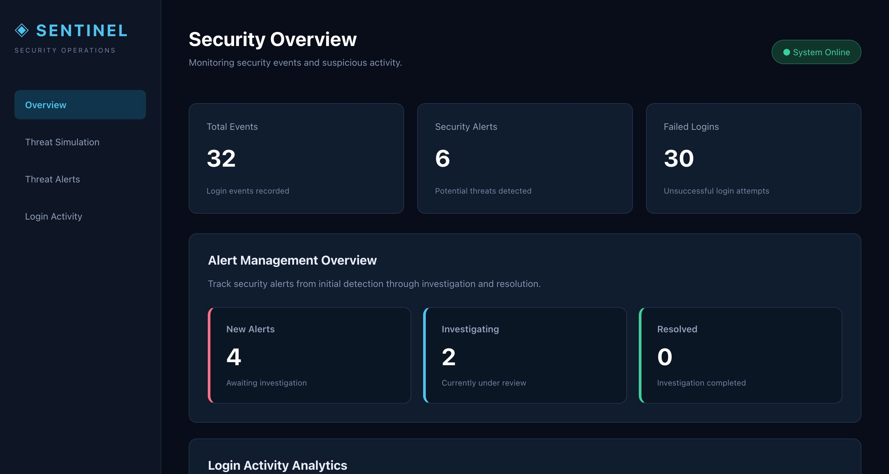
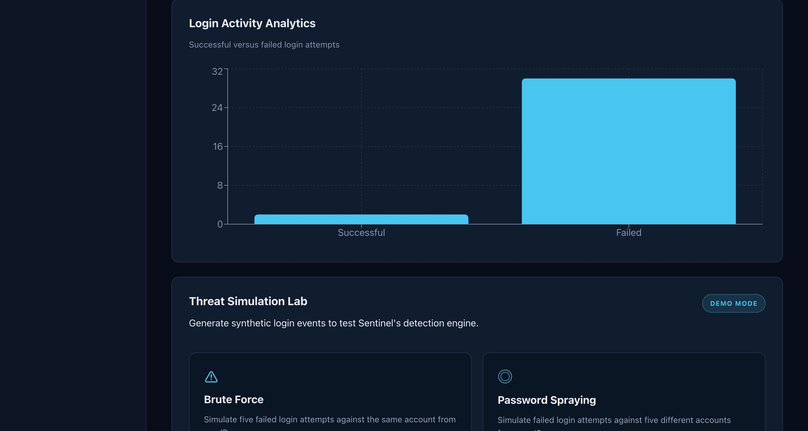
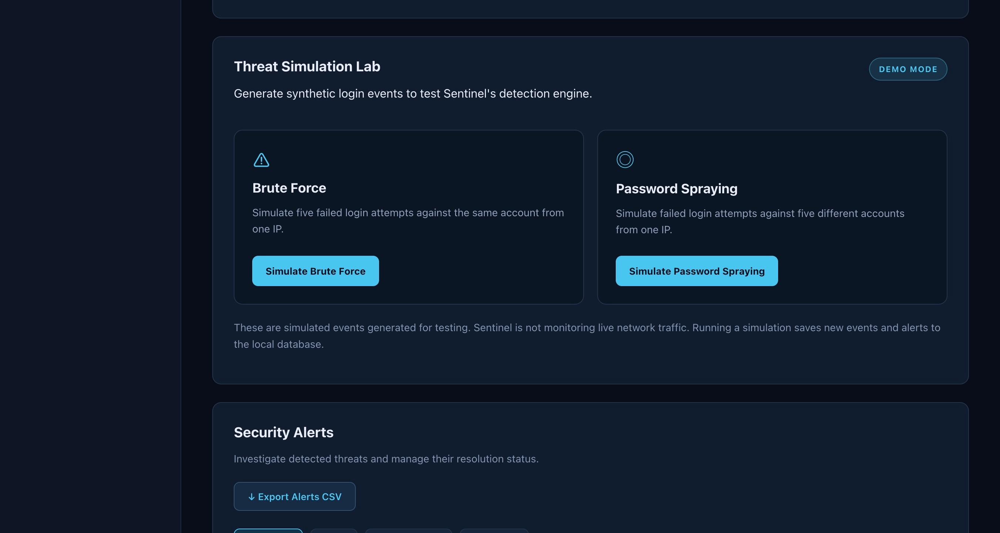
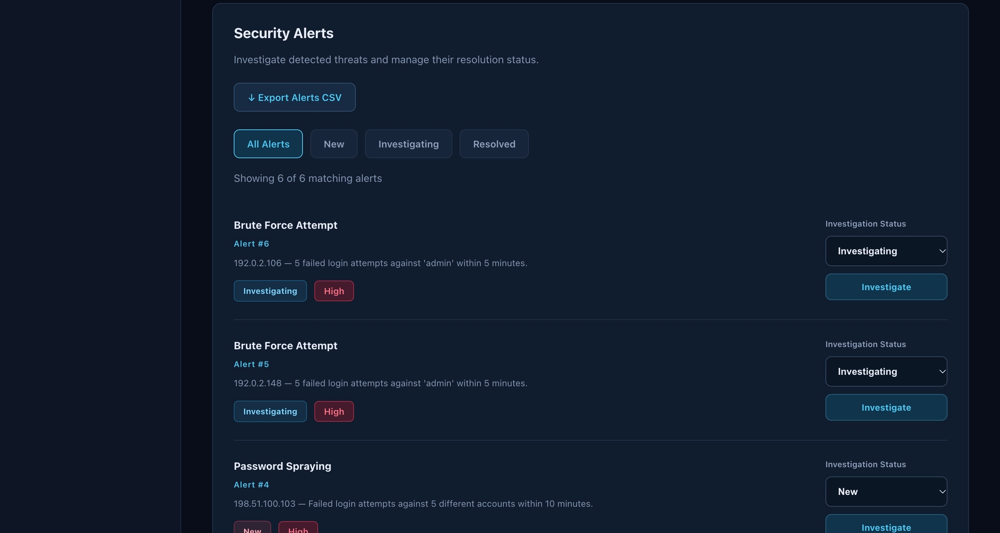
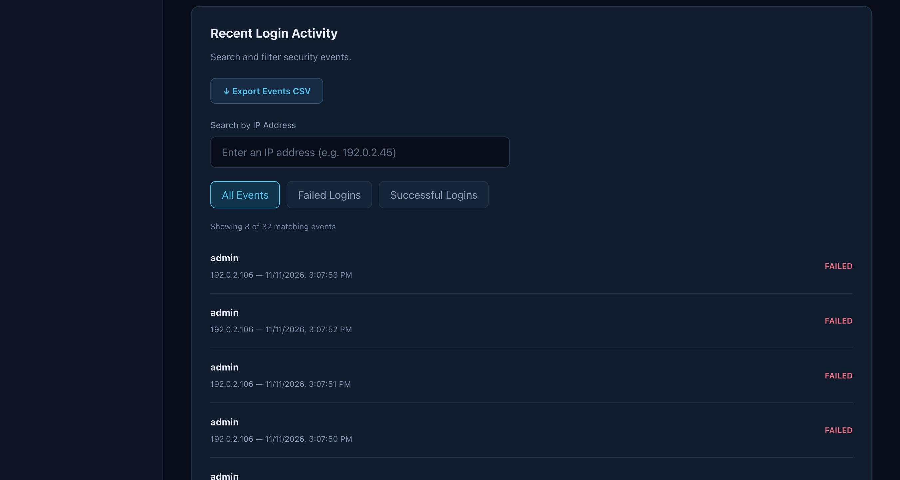
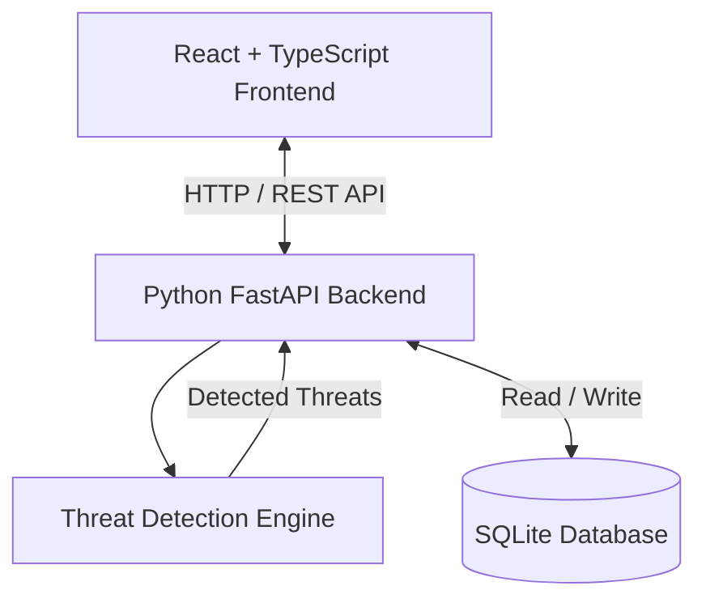

# Sentinel — Security Operations Dashboard


[](https://github.com/srochdi/Sentinel/actions/workflows/backend-tests.yml)


## Dashboard Screenshots

### Security Overview


### Login Activity Analytics


### Threat Simulation Lab


### Security Alert Management


### Recent Login Activity


---

Sentinel is a full-stack cybersecurity portfolio project designed to detect, investigate, and manage suspicious authentication activity.

The application analyzes login events, identifies potential security threats, and provides an interactive dashboard for security investigation and incident management.

## Features

### Threat Detection
- Detects brute-force login attempts.
- Detects password-spraying attacks.
- Analyzes authentication activity using configurable time-window logic.
- Associates detected threats with their triggering login events.

### Security Dashboard
- Interactive React and TypeScript interface.
- Security statistics and login activity charts.
- Searchable authentication events.
- Filters for successful and failed login attempts.
- Automatic dashboard refresh.

### Alert Management
- Security alert tracking.
- New, Investigating, and Resolved statuses.
- Persistent status updates using SQLite.
- Alert filtering and investigation tools.

### Security Investigations
- Detailed investigation panel for each alert.
- Source IP identification.
- Affected account tracking.
- Exact and historical event correlation.
- Investigation notes stored in SQLite.

### Threat Simulation
- Built-in brute-force simulation.
- Built-in password-spraying simulation.
- Synthetic authentication events for testing.
- Clearly identified demonstration mode.

### Reporting
- Export security alerts to CSV.
- Export authentication events to CSV.
- Include investigation notes in alert reports.


## System Architecture



Sentinel uses a React frontend to display authentication activity and security alerts. The FastAPI backend processes requests, executes threat detection logic, and stores events, alerts, and investigation information in SQLite.


## Technology Stack

**Frontend**
- React
- TypeScript
- Vite
- Recharts
- CSS

**Backend**
- Python
- FastAPI
- SQLite
- Pydantic

**Testing**
- pytest
- FastAPI TestClient
- 31 automated tests

## Project Structure

```text
Sentinel/
├── backend/
│   ├── main.py
│   ├── detector.py
│   ├── database.py
│   ├── test_api.py
│   └── test_detector.py
├── frontend/
│   ├── src/
│   │   ├── App.tsx
│   │   └── App.css
│   └── package.json
├── .gitignore
└── README.md
```

## Getting Started

### Backend Setup

Requires Python 3 and Node.js.

Open a terminal in the project directory:

```bash
cd backend

python3 -m venv .venv

source .venv/bin/activate

pip install fastapi uvicorn pytest httpx
```

Start the backend:

```bash
python -m uvicorn main:app --reload
```

The API runs at:

http://127.0.0.1:8000

Interactive API documentation:

http://127.0.0.1:8000/docs

### Frontend Setup

Open a second terminal:

```bash
cd frontend

npm install

npm run dev
```

Open the local URL displayed by Vite in your terminal.

## Running Tests

From the backend directory:

```bash
python -m pytest -v
```

The project currently includes 31 passing automated tests.

## Security Considerations

Sentinel is an educational and portfolio demonstration project.

- Simulated authentication events do not represent live network monitoring.
- SQLite stores alert and investigation data locally.
- Local database files and environment files are excluded from Git.
- CSV reports may contain sensitive investigation information.
- Authentication, authorization, and production deployment security controls would be required before using Sentinel in a real security operations environment.

## Future Improvements

- User authentication and role-based access control.
- Real-time security event ingestion.
- Additional attack detection rules.
- Advanced analytics and threat visualization.
- Incident assignment and audit logging.
- Production deployment and monitoring.

## About

Sentinel demonstrates full-stack application development, security event analysis, database design, REST API development, and automated software testing.
